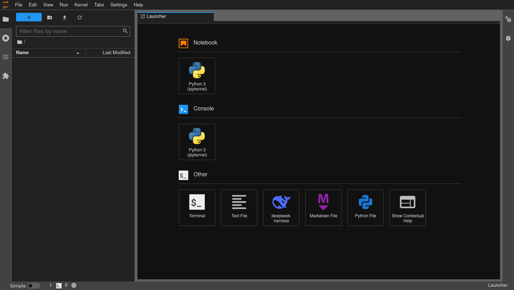
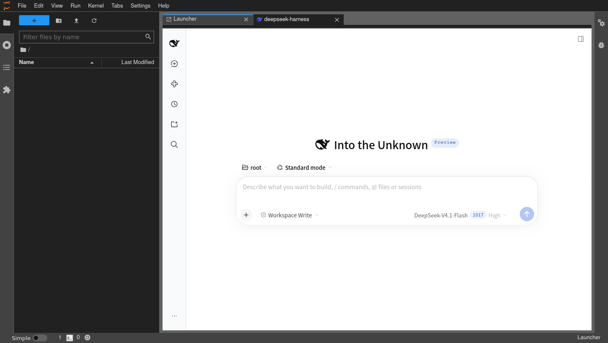

# jupyterlab-dsh — DeepSeek Harness (dsh) inside JupyterLab

English | [中文](README.zh.md)

[](LICENSE)

Adds a `deepseek-harness` card to the **"Other" row of the JupyterLab launcher
(the row that holds Terminal)** with the official dsh mark; clicking it opens
the DeepSeek Harness web GUI as a main-area tab. It works no matter which
address JupyterLab listens on — including `0.0.0.0` reached from an external
IP.


```
Browser (any external IP:port)
   └── JupyterLab (0.0.0.0:8888, Jupyter session auth)
         └── /dsh/            ← this plugin: same-origin reverse proxy (server ext)
               ├── ?token= exchanged for a signed cookie server-side (token never reaches the browser)
               ├── Host/Origin rewritten to 127.0.0.1:<port> (passes the dsh fence)
               ├── Set-Cookie Path=/ → Path=/dsh/ (cookie scope remount)
               ├── WebSocket (/dsh/api/remote.mux) bidirectional tunnel (chat / event stream)
               └── 127.0.0.1:<random port> ← dsh web child process
                     (upstream refuses 0.0.0.0 binds; this extension owns the process)
```

The `deepseek-harness` launcher card in the **Other** row (official dsh mark,
right next to Terminal):



After clicking the card, the dsh GUI is embedded as a JupyterLab tab
(model DeepSeek-V4.1-Flash):



## Components

| Part | Location | Role |
|---|---|---|
| server extension | `jupyterlab_dsh/` (Python) | Spawns/supervises the `dsh web` child; reverse proxy (HTTP + WS) at `<base_url>dsh/`; health check at `<base_url>dsh-ext/status` |
| labextension | `labextension/` (TypeScript) | Launcher card in the "Other" row + iframe main-area tab (singleton reuse) |

### How the forwarding security restrictions are solved

* dsh's Host/Origin fence only accepts loopback / the bind IP /
  `--trusted-host`; a browser hitting it via an external address gets 403.
  The proxy forwards everything to `127.0.0.1`, so **any** external address
  passes, and dsh's authority-bound session cookie is always validated
  against the same authority.
* The launch token (a process credential) is held server-side and exchanged
  there; it never appears in a browser URL.
* Jupyter side: every `/dsh/` request still requires an authenticated
  Jupyter session (`@web.authenticated`); only the `_xsrf` check is disabled
  for this path (the dsh frontend cannot carry Jupyter's xsrf token) — the
  backend is still protected by dsh's own signed cookie.
* Proxied responses strip `X-Frame-Options` / `Content-Security-Policy` /
  COOP so the same-origin iframe can embed; every other header passes
  through untouched.

## Requirements

| Dependency | Version | Purpose |
|---|---|---|
| JupyterLab / jupyter-server | **3.3+ or 4.x** / ≥1.8 | host — one prebuilt bundle serves both generations (verified on 3.6.8 and 4.5.6; see [docs/jupyterlab3-4-compat.md](docs/jupyterlab3-4-compat.md)) |
| Node.js | **≥ 24.9** | only needed by the `dsh` runtime (not by JupyterLab itself) |
| @deepseek-ai/dsh | latest | dsh CLI (`npm i -g @deepseek-ai/dsh`) |
| DeepSeek API key | — | added by the user in the dsh UI **Settings → Models** after install (env-var `DEEPSEEK_API_KEY` injection is optional) |

Model note: the DeepSeek API currently exposes model IDs `deepseek-flash`
(DeepSeek-V4.1-Flash, the default route) and `deepseek-v4-pro`; there is **no**
ID named `deepseek-v4-flash`.

## Manual installation (on the target server)

### 1. Install Node.js ≥ 24.9 and the dsh CLI

```bash
# Node.js 24 (official dist; CN mirror: https://registry.npmmirror.com/-/binary/node/)
curl -fsSL https://nodejs.org/dist/v24.12.0/node-v24.12.0-linux-x64.tar.xz \
  | tar -xJ -C /opt && ln -sf /opt/node-v24.12.0-linux-x64/bin/{node,npm,npx} /usr/local/bin/

# dsh CLI (switch to the CN mirror registry first if needed)
npm config set registry https://registry.npmmirror.com   # optional
npm install -g @deepseek-ai/dsh
dsh --help    # should print usage
```

### 2. Install this plugin

Download `jupyterlab_dsh-0.1.0-py3-none-any.whl` from
[Releases](../../releases), then:

```bash
pip install jupyterlab_dsh-0.1.0-py3-none-any.whl

# The wheel automatically provides:
#   * the jupyterlab_dsh Python package
#   * <prefix>/share/jupyter/labextensions/jupyterlab-dsh   (frontend, no build needed)
#   * <prefix>/etc/jupyter/jupyter_server_config.d/jupyterlab_dsh.json (auto-enabled)

jupyter server extension list   # should list jupyterlab_dsh ... enabled
jupyter labextension list       # should list jupyterlab-dsh v0.1.0 enabled OK
```

### 3. Start, add your key, verify

```bash
jupyter lab --ip 0.0.0.0 --port 8888 --no-browser --allow-root
```

```bash
# Health check (the dsh child starts with Jupyter; cold start ~20-30s)
curl -s "http://127.0.0.1:8888/dsh-ext/status"        # {"ready": true, ...}
```

Open `http://<any server IP>:8888/` in a browser, click the
`deepseek-harness` card in the launcher's **Other** row, then do a one-time
setup:

1. **Settings → Models**: paste your [DeepSeek API key](https://platform.deepseek.com/)
   and save — the model route (`deepseek-flash`) works immediately, no restart needed;
2. **Choose workspace**: pick the Jupyter root directory as the workspace;
3. Send your first task.

> If you prefer environment variables, `DEEPSEEK_API_KEY=sk-xxx jupyter lab ...`
> works too — either way is fine; the UI is the recommended default.

## AI-assisted installation (hand this prompt to an AI agent on the server)

Paste the prompt below to a command-capable AI assistant on the target server
(Claude Code / ZCode / Codex …), replacing `<...>` placeholders:

```text
Please install and verify jupyterlab-dsh on this server (a JupyterLab
integration of DeepSeek Harness; GitHub repo MasterChiefm/jupyterlab-dsh).

1. Download jupyterlab_dsh-0.1.0-py3-none-any.whl from the repo's GitHub
   Releases (configure a proxy or mirror first if the network is restricted).
2. Check and satisfy the prerequisites:
   - Node.js >= 24.9 (only the dsh runtime needs it, not JupyterLab).
     On restricted networks, fetch node-v24.12.0-linux-x64.tar.xz from
     https://registry.npmmirror.com/-/binary/node/v24.12.0/ and symlink
     node/npm/npx.
   - Install the global npm package @deepseek-ai/dsh (first run
     npm config set registry https://registry.npmmirror.com on CN networks).
   - Confirm JupyterLab 3.x and jupyter-server>=1.8 are installed.
3. pip install the wheel, then run `jupyter server extension list` and
   `jupyter labextension list` and confirm jupyterlab_dsh / jupyterlab-dsh
   are both enabled.
4. Start it (no API key is needed):
   jupyter lab --ip 0.0.0.0 --port <port> --no-browser
5. Verify:
   a. curl http://127.0.0.1:<port>/dsh-ext/status until it returns
      "ready": true (dsh cold-starts in ~20-30s; use an authenticated
      jupyter token/cookie);
   b. curl -D - the /dsh/ entry and confirm HTTP 200 and that the
      Set-Cookie Path is rewritten to /dsh/;
   c. with a browser (or headless browser) open http://<server-ip>:<port>/
      and confirm the deepseek-harness card appears in the launcher's
      Other row and loads the dsh UI when clicked.
6. When done, tell the user: the DeepSeek API key is entered by the user
   themselves in the dsh UI under Settings → Models (no restart needed;
   model deepseek-flash works immediately). Do not ask me for a key and do
   not write any key into files.
7. Note: use model deepseek-flash (DeepSeek-V4.1-Flash) or deepseek-v4-pro;
   there is no model ID deepseek-v4-flash.
If anything fails, consult the repo README's manual-install section and
AGENTS.md for troubleshooting.
```

## Configuration (jupyter_server_config.py)

```python
c.DshExtensionConfig.port = 0         # loopback port for dsh; 0 = random (default, conflict-free)
c.DshExtensionConfig.command = ""     # custom launch command, e.g. "dsh web --no-open --port 3080"
c.DshExtensionConfig.autostart = True # start dsh with Jupyter (process group dies with it)
```

The dsh working directory follows Jupyter's root_dir.

## FAQ (common deployment scenarios)

### The server only has JupyterLab — what happens after installing the plugin?

**JupyterLab itself is completely unaffected**; everything else works. The
wheel installs, the extension enables, the launcher card appears; clicking it
shows a clear error page (503, "could not start dsh …") that auto-refreshes
every 3s — the machine simply has no `dsh` command yet. The supervisor keeps
retrying with exponential backoff (capped at 30s). Install Node ≥ 24.9 and
`npm i -g @deepseek-ai/dsh` at any later time — without restarting
JupyterLab — and within 30s the plugin brings dsh up and the error page
self-heals into the working GUI. "Plugin first, dependencies later" is a
valid order.

### Both JupyterLab and deepseek-harness are installed — must I start both manually?

**No — starting JupyterLab is the only command you need.** With
`autostart=True` (default) the extension launches `dsh web` as a child
process (ready in ~20–30s); a crashed dsh is restarted automatically (refresh
the tab to reconnect — the signing secret persists in `$DSH_HOME`, so the old
session cookie stays valid); when Jupyter exits, dsh is killed as a process
group with no orphans.

**Do not run your own `dsh web` for the plugin** — the extension must spawn
the child itself to parse the per-process launch token from its stdout and
perform the server-side exchange; a manually started instance is invisible
to it.

### deepseek-harness is running on a different port — what do I do?

* **You want the plugin's own dsh on a fixed port** (default 0 = random
  loopback port):
  ```python
  c.DshExtensionConfig.port = 3080   # plugin launches dsh web --no-open --port 3080
  ```
  The port must be free; if occupied, dsh fails to start, the plugin shows
  the error page and keeps retrying.
* **You already run your own dsh instance on another port**: nothing to do —
  they coexist naturally. The plugin's instance uses a random loopback port
  and never conflicts; keep using your dsh as-is while the plugin runs its
  own instance inside JupyterLab (`$DSH_HOME` storage is shared; sessions
  are per-process). Proxying to an external existing dsh instance is not
  supported, because that instance's process token is not accessible and the
  browser session exchange cannot be performed.
* **dsh is not on PATH or needs custom launch arguments**:
  ```python
  c.DshExtensionConfig.command = "/opt/node24/bin/dsh web --no-open --port 3080"
  ```

Note: if you configure a fixed port while your own dsh runs on the same
port, they fight over it (whichever starts later fails and retries) — set
`port = 0` back or give them different ports.

## Building from source (only needed when changing code)

```bash
cd labextension && jlpm install && jlpm run build   # tsc + jupyter labextension build
cd .. && pip wheel . --no-deps -w dist/
```

Build details and dependency traps (webpack must be pinned to 5.44.0, node
DNS flags, …) are in [AGENTS.md](AGENTS.md).

## Verified

With JupyterLab listening on `0.0.0.0` and accessed from an external IP:
`/lab` 200, `/dsh/` (server-side token exchange, cookie `Path=/dsh/`
rewrite), API POST (fence passed), WebSocket upgrade at
`/dsh/api/remote.mux` (101 established) — all pass; the launcher shows the
`deepseek-harness` card and the iframe loads a fully working dsh GUI.

End-to-end launcher-click acceptance (headless Chromium) passes on both
**JupyterLab 3.6.8** and **JupyterLab 4.5.6** with the same prebuilt bundle:
click completes in <0.1 s, the UI thread stays responsive, and the dsh GUI
boots inside the tab. Background: [docs/jupyterlab3-4-compat.md](docs/jupyterlab3-4-compat.md).

## License

MIT © MasterChiefm
